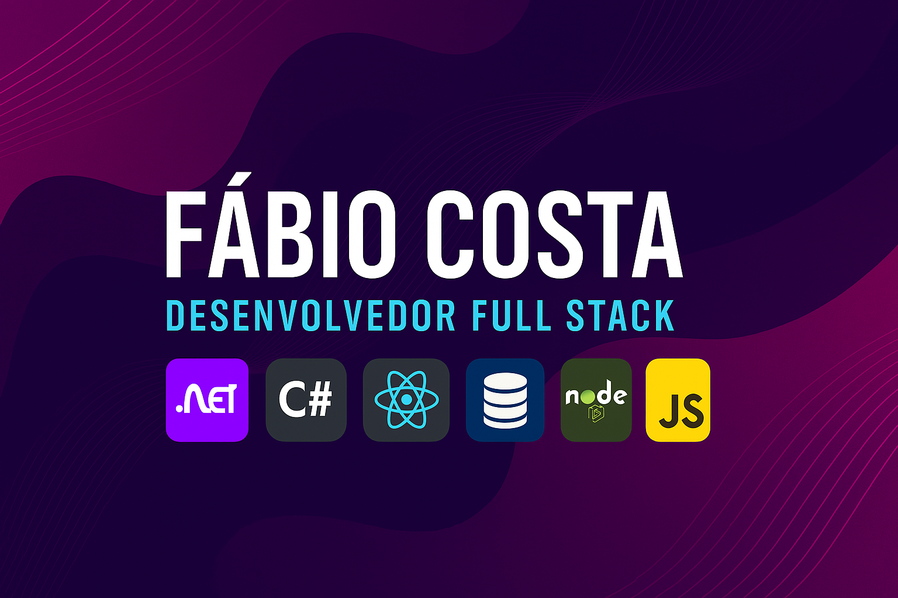

  

# Fábio Costa Silva

Desenvolvedor com foco em back-end com .NET e C# e em front-end e full stack com React, Next.js, TypeScript, JavaScript e MySQL. Nos projetos recentes em destaque, o banco usado é PostgreSQL.

## Tecnologias

  
  
  
  
  
  
  
  

## Projetos em destaque

### Fluxus PDV

Frente de caixa com estoque, clientes, financeiro e pagamentos (dinheiro, PIX e cartão). Next.js, TypeScript e PostgreSQL.

[Repositório](https://github.com/fabiocosta123/pdv_fluxus) · [Demo](https://pdv-fluxus.vercel.app)

### Anexa

Plataforma de ensino a distância: cursos, conteúdos e dúvidas entre alunos e professores. A API é ASP.NET Core (C#, .NET 10); a interface é Next.js e TypeScript.

[API](https://github.com/fabiocosta123/educational_platform) · [Front-end](https://github.com/fabiocosta123/educational_plataform_frontend) · [Demo](https://educational-plataform-frontend.vercel.app)

### Planejar+

Planejamento financeiro familiar, com lançamentos, contas, saldo e a projeção de quando o dinheiro aperta. Next.js, TypeScript e PostgreSQL.

[Repositório](https://github.com/fabiocosta123/planejar-) · [Demo](https://planejar-wheat.vercel.app)

### Ser Mulher

Loja virtual de cosméticos, com catálogo, carrinho e provador virtual. Next.js e TypeScript.

[Repositório](https://github.com/fabiocosta123/sermulher) · [Demo](https://sermulher.vercel.app)

## Outros projetos

### Mente Aberta

Sistema de gerenciamento de biblioteca (livros, usuários e empréstimos). O repositório se chama Bookshelf. Next.js e TypeScript.

[Repositório](https://github.com/fabiocosta123/bookshelf) · [Demo](https://bookshelf-chi-five.vercel.app/)

### Academia Alisson Godoy

Site institucional, com layout responsivo. HTML, CSS e JavaScript.

[Repositório](https://github.com/fabiocosta123/academia_alisson_godoy) · [Demo](https://fabiocosta123.github.io/academia_alisson_godoy/)

## Certificações

- Curso AWS, concluído em outubro de 2026
- Huawei eKit SME Junior Engineer Certification, outubro de 2026

## Contato

- [GitHub](https://github.com/fabiocosta123)
- [LinkedIn](https://www.linkedin.com/in/fabio-costa-silva-/)
